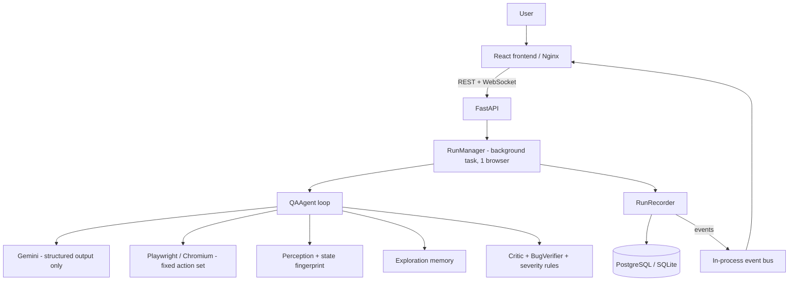

# AgentQA Cloud

Autonomous QA for the modern web. Give it a URL and a goal; an AI agent (Gemini + Playwright) explores the app,
builds an exploration graph, detects and **verifies** bugs, and reports them with evidence.

## Overview
- **Landing → Dashboard → New run → Live agent → Results** (graph, bugs, metrics, evidence).
- Everything shown comes from real execution: real Chromium, real Gemini calls, real PostgreSQL rows, real WebSocket events. When Gemini is unavailable the run continues with a deterministic built-in explorer and says so in the activity log.

## Features
Autonomous loop with limits (`MAX_STEPS`, `MAX_RUNTIME`, `MAX_DEPTH`, `MAX_RETRIES`) · validated action set only · exploration graph (React Flow) with search, details panels, current/unexplored/bug highlighting · bug pipeline (critic → re-observe → safe replay → confidence → verified/unverified/discarded) · de-duplication by fingerprint · severity with stored rationale · bug workflow (open/resolved), Markdown/JSON export · optional **candidate fix** suggestions (diff only) · projects with allowed domains and default goals · run history with search/filters/pagination · evaluation metrics · dashboard analytics · light/dark theme · retention controls.

## Architecture

`backend/app`: `api/ agent/ browser/ llm/ perception/ exploration/ bugs/ fixes/ evaluation/ services/ database/ models/ schemas/ core/`.

## Tech stack
Python 3.11+, FastAPI, SQLAlchemy 2 (async) + Alembic, Playwright/Chromium, Google Gemini · React 18, TypeScript, Vite, Tailwind, React Router, TanStack Query, React Flow, Lucide · PostgreSQL (SQLite for trials) · Docker/Nginx (optional). No Redis, Neo4j, Ollama or Kubernetes required.

## Prerequisites
Python 3.11+, Node 20+, a Gemini API key (https://aistudio.google.com/apikey). PostgreSQL optional. Docker optional.

## Installation & running locally
**Windows (PowerShell)** — see [WINDOWS.md](WINDOWS.md):
```powershell
.\scripts\setup.ps1     # venv + deps + chromium + npm install + .env
notepad .env            # set GEMINI_API_KEY
.\scripts\dev.ps1       # backend :8000, frontend :5173   (add -Demo for the demo shop)
```
Manual:
```powershell
cd backend; python -m venv venv; .\venv\Scripts\Activate.ps1
pip install -r requirements.txt; playwright install chromium
python run.py                 # NOT plain `uvicorn --reload` on Windows (see Troubleshooting)
cd ..\frontend; npm install; npm run dev
```
macOS/Linux: same, with `source venv/bin/activate`. API docs: http://localhost:8000/docs.

## Running with Docker
```bash
cp .env.example .env      # set POSTGRES_PASSWORD, GEMINI_API_KEY
docker compose up --build # UI :8080, API :8000
docker compose --profile demo up --build   # also the demo shop
```
Services: `db` (Postgres), `backend` (FastAPI + Chromium, runs `alembic upgrade head` on start, health check `/api/health`), `frontend` (Nginx), optional `demo-shop`. Compose files were written carefully but **could not be built in the authoring environment (no Docker daemon)** — run `docker compose build` once and report issues.

## Environment variables
See `.env.example` (all documented). Key ones: `GEMINI_API_KEY`, `GEMINI_MODEL`, `DATABASE_URL`, `ALLOWED_DOMAINS`, `BROWSER_ALLOW_PRIVATE_NETWORKS` (default **false**), `MAX_STEPS`, `MAX_RUNTIME`, `MAX_DEPTH`, `MAX_RETRIES`, `MAX_CONCURRENT_BROWSERS` (default 1), `BROWSER_HEADLESS`, `FIX_AGENT_ENABLED` (default false), `MAX_ARTIFACT_SIZE`, `MAX_SCREENSHOTS_PER_RUN`, `RUN_RETENTION_DAYS`, frontend `VITE_API_URL`.

## Creating a QA run
Projects → New project (or just start a run; a project is created per origin) → **Run QA test** → URL + goal → *Start autonomous QA*. Watch Overview/Timeline live; open Graph, Bugs, Screenshots, Metrics. Stop/Pause/Resume at any time; finished runs stay in history.

## Understanding the agent
Each step: observe page → fingerprint state → check memory → Gemini proposes one action (JSON, schema-validated) → policy check (allowed domains, repeat/loop limits, sensitive fields) → Playwright executes → critic compares expected vs actual → bugs verified → graph/memory updated. The model can only choose `OPEN, CLICK, TYPE, SELECT, SCROLL, PRESS, BACK, FORWARD, RELOAD, WAIT, SCREENSHOT, FINISH` on elements referenced by opaque IDs. No shell, Python, JavaScript or filesystem access exists in the action schema. `agent_thinking` events carry one short sentence, never raw reasoning. Stops on: max steps, max runtime, unreachable site, nothing useful left, loop/stagnation, fatal browser error, user stop. If Gemini fails, the deterministic explorer takes over.

## Exploration graph
Nodes = UI states (deterministic hash of normalized URL, title, text, interactive elements, accessibility structure; never raw DOM). Edges = executed actions with expected/actual result. Updates live while a run is active. *Unexplored* = state with interactive elements never exercised.

## Bug detection
Evidence (console, network, exceptions, blank page, failed expectations) → critic (rules; Gemini may add judgement but cannot dismiss hard evidence) → re-observation → safe replay (only idempotent actions; buttons/typing are **never** repeated) → confidence recalculated → `verified` / `unverified` / discarded. Reproduction steps are the real recorded path to the triggering action. Severity = critic + explicit rules (`bugs/severity.py`), rationale stored.

## Candidate fixes (optional)
`FIX_AGENT_ENABLED=true` adds “Generate candidate fix” on a bug. You may paste relevant source; the service returns summary, root cause, before/after and a diff built locally with `difflib`, plus a verification plan. It never reads your filesystem, runs commands or modifies code; without pasted source it only offers a hypothesis (confidence capped at 0.4).

## Security
SSRF: http(s) only; localhost, `0.0.0.0`, private/link-local/reserved IPv4+IPv6 and cloud-metadata blocked by default and re-checked on every navigation and redirect; `file:`/`javascript:`/`data:` rejected; `ALLOWED_DOMAINS` (+ per-project domains) enforced at creation and in the browser (the agent cannot leave them). Browser: isolated context per run, downloads blocked, time/step/depth budgets, cleanup on every exit. Secrets: API key never sent to the frontend or logged (log processor redacts), credentials live in memory for one run, injected as `{{USERNAME}}`/`{{PASSWORD}}` so the model never sees them, and API responses never include them. Debug endpoints (`/api/browser`, `/api/ai`) are off unless `ENABLE_DEBUG_ENDPOINTS=true`. Unhandled errors return a generic 500. **Auth is optional**: use a dedicated test account; do not enable private-network targets on a shared deployment.

## Testing
```bash
cd backend && pytest -q          # unit, API, WebSocket, DB, real-Chromium end-to-end on the demo shop
cd frontend && npm run lint && npm run build
```
Demo shop (`demo-app/`) has 6 intentional, documented bugs (`known_bugs.json`); `tests/test_e2e_demo_shop.py` asserts real findings and zero false positives.

## Evaluation
Per run: `GET /api/runs/{id}/evaluation` (Metrics tab): states, transitions, pages, tested elements, verified/unverified, candidates, false positives, verification rate, time-to-first-bug, action efficiency, **estimated** coverage (tested ÷ observed elements — not a share of the whole app). Against ground truth:
```bash
python -m app.evaluation.run_eval --api http://localhost:8000 --url http://127.0.0.1:8080 --truth ../demo-app/known_bugs.json
```
Reports detection rate (split rule-detectable vs LLM-detectable), unmatched reports and false-positive rate.

## Project structure
```
backend/app/{api,agent,browser,llm,perception,exploration,bugs,fixes,evaluation,services,database,models,schemas,core}
backend/alembic/versions/0001-0003   backend/tests/
frontend/src/{pages,components,hooks,api,types,layouts,lib}
demo-app/            intentional-bug demo shop + known_bugs.json
scripts/             setup.ps1 dev.ps1 test.ps1
docker-compose.yml  .env.example  WINDOWS.md
```

## Troubleshooting
See WINDOWS.md. Common: *Target rejected (private)* → intended, see Security; *Disconnected* → backend not on `VITE_API_URL`; *no AI decisions* → set `GEMINI_API_KEY`; *`NotImplementedError` on Windows* → start with `python run.py` or `uvicorn ... --loop none` (plain `--reload` forces a loop that cannot spawn the browser); *Chromium missing* → `playwright install chromium`; schema errors on an existing DB → `alembic upgrade head`.

## Future improvements
Redis-backed event bus for multi-worker deployments; Neo4j graph store (interface in `exploration/store.py`); run resume after restart; saved auth profiles; scheduled runs; CI integration.
